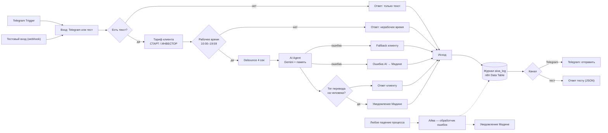

# Айва — ИИ-ассистент брокера в n8n

Айва отвечает клиентам Freedom Broker на вопросы о тарифах, комиссиях и открытии счёта, а при стоп-сигналах (сумма от $100 000, паника, родственник, явное недовольство) передаёт диалог живому брокеру — Мадине.

Канал для демо — Telegram-бот (n8n локально в Docker + Cloudflare Tunnel). Исходная версия на WhatsApp (GreenAPI) лежит рядом для истории.

## Воркфлоу

| Файл | Что делает |
|---|---|
| `workflows/aiva-telegram.json` | Основной процесс: Telegram / тестовый вход → проверки → AI-агент → журнал → доставка |
| `workflows/aiva-error-handler.json` | Обработчик ошибок: ловит любое падение основного процесса, пишет в журнал и уведомляет Мадину в Telegram |
| `workflows/aiva-whatsapp-greenapi.json` | Первая версия на WhatsApp через GreenAPI (неактивна) |

## E2E-процесс



### Обработка ошибок

| Уровень | Что ловит | Что происходит |
|---|---|---|
| Узел AI Agent (`continueErrorOutput`, 2 попытки) | Сбой Gemini: 429 лимит, 503 перегрузка, 404 модель | Клиенту — вежливая заглушка, Мадине — «сбой AI Agent», строка `ai_error` в журнале |
| Error workflow «Айва — обработчик ошибок» | Любое необработанное падение основного процесса | Строка `workflow_error` в журнале + уведомление в Telegram: воркфлоу, узел, текст ошибки, номер запуска |
| Бизнес-ветки | Не текст, нерабочее время | Понятный ответ клиенту без вызова AI (`non_text`, `after_hours`) |

### Журнал `aiva_log`

Каждое отправленное сообщение — одна строка во встроенной таблице n8n (Data Table):
`logged_at, source (telegram / test / error_handler), test_case, chat_id, kind (client / notify), status, question, answer, error, duration_ms, workflow`.

Статусы: `answered`, `transferred`, `ai_error`, `after_hours`, `non_text`, `workflow_error`.

## Тестирование

Автотесты гоняются через тестовый вход `POST /webhook/aiva-test` (ключ в теле запроса, без ключа вызов игнорируется). На тестовом входе ответ возвращается в JSON вместо отправки в Telegram.

```powershell
$env:AIVA_TEST_KEY = '<ключ из узла «Вход: Telegram или тест»>'
./tests/run_tests.ps1
```

Итоги (16.10.2026): **21 кейс**, первый прогон — 17 / 19, после исправлений — **21 / 21**.
Время ответа AI: в среднем 11,7 сек (8–21 сек), из них 4 сек — ожидание серии сообщений (debounce).

- Таблица кейсов: [`tests/test-report.csv`](tests/test-report.csv)
- Баги: [`tests/bugs.md`](tests/bugs.md)

## Как запустить

1. n8n в Docker: `docker run -d --name n8n -p 5678:5678 -v n8n_data:/home/node/.n8n -e WEBHOOK_URL=<публичный https-адрес>/ n8nio/n8n`
2. Публичный адрес для Telegram — Cloudflare Tunnel: `docker run -d --name cft cloudflare/cloudflared tunnel --url http://host.docker.internal:5678`
3. Импортировать оба JSON из `workflows/`, подключить credentials: Telegram (токен бота от @BotFather) и Google Gemini.
4. В узле «Вход: Telegram или тест» вписать свой `MADINA_CHAT_ID` и `TEST_KEY`.
5. В настройках основного воркфлоу выбрать Error workflow «Айва — обработчик ошибок», активировать оба.

Все токены, телефоны и chat id в файлах заменены на плейсхолдеры `YOUR_…`.
